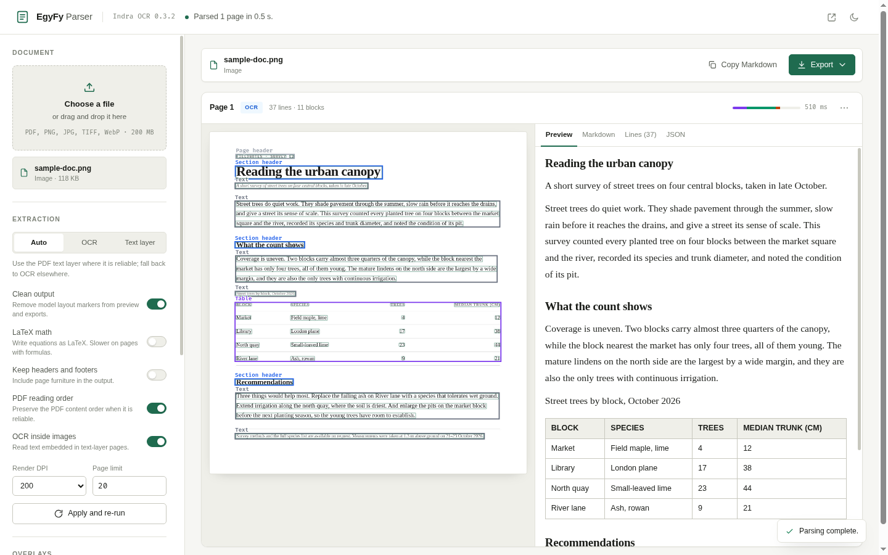

# EgyFy Parser

EgyFy Parser is a local OCR workspace for PDFs and scanned images. It reads a
document, shows the result page by page, and exports clean Markdown, text,
JSON, and tables. Everything runs on your machine through Indra OCR, so your
files are never sent to an online service.

Built by **Arab Open Source**.



## What it does

- Reads PDFs, PNG, JPG, TIFF, and WebP files.
- Uses the PDF text layer, OCR, or a mix of both, depending on page quality.
- Shows a preview of every page with its extracted text, line confidence,
  layout blocks, and raw JSON.
- Draws line boxes, layout blocks, labels, and reading order over the page so
  you can check the result before exporting.
- Exports Markdown, plain text, lines CSV, JSON, a standalone HTML page, a
  tables package, or a ZIP with all of them.
- Removes OCR layout markers and stray table pipes from the output with one
  setting.
- Keeps documents and extracted text on the local machine.

## Requirements

- Python 3.10 or newer.
- Indra OCR 0.3.2 and its runtime dependencies: ONNX Runtime, OpenCV,
  pypdfium2, NumPy, and the Hugging Face client.
- A CPU and enough memory for the OCR models and page previews. A GPU is not
  required.
- Internet access on the first run to download the OCR models, unless you
  already have a local model folder.

`indra-ocr` is pinned in `requirements.txt` because newer Indra releases changed
the OCR interface used by the app.

## Install Indra OCR and run the app

### 1. Create a virtual environment

From the project directory:

```bash
python3 -m venv .venv
.venv/bin/python -m pip install --upgrade pip
```

### 2. Install Indra OCR

Indra OCR is a Python package installed from PyPI; no separate download or
build step is needed. The project pins version 0.3.2 in `requirements.txt`:

```bash
.venv/bin/python -m pip install -r requirements.txt
```

To install the OCR engine on its own, use the same version explicitly:

```bash
.venv/bin/python -m pip install indra-ocr==0.3.2
```

Check the installation:

```bash
.venv/bin/python -c "import indra_ocr; print(indra_ocr.__version__)"
```

The command should print `0.3.2`.

### 3. Download the OCR models

Indra downloads its model files from Hugging Face the first time it reads a
document. To download them before starting the app, run:

```bash
.venv/bin/python -c "from indra_ocr import model_dir; print(model_dir())"
```

The command downloads the models and prints the cache folder. Hugging Face
stores them in `~/.cache/huggingface` by default; set `HF_HOME` to use another
location. The math models are downloaded separately the first time **LaTeX
math** is enabled.

If the machine has no internet access, copy a model folder to it and start the
app with:

```bash
./run.sh --model-dir /path/to/models
```

A local folder must contain `det.onnx`, `rec.onnx`, `order.onnx`, and
`meta.json`. For LaTeX math it also needs `mathcls.onnx`, `math_enc.onnx`,
`math_dec_init.onnx`, `math_dec_step.onnx`, and `math_meta.json`.

### 4. Start the app

```bash
./run.sh
```

Open <http://localhost:8770>. The first start can take longer if the models
have not been downloaded yet.

If Indra is already installed in another environment, point the launcher at it:

```bash
EGYFY_PYTHON=/path/to/venv/bin/python ./run.sh
```

You can also start the server directly:

```bash
/path/to/venv/bin/python -m egyfy
```

`run.sh` checks `EGYFY_PYTHON`, `INDRA_PYTHON`, `./.venv`, `../indra/.venv`,
`~/indra/.venv`, and finally `python3`, and uses the first interpreter that can
import `indra_ocr`.

On Windows, activate the environment and use `python -m egyfy`; `run.sh` is a
Bash script.

### Command-line options

| Option | Default | Meaning |
| --- | --- | --- |
| `--host` | `127.0.0.1` | Address to bind. Keep the default for local use. |
| `--port` | `8770` | HTTP port. |
| `--threads` | `4` | ONNX Runtime worker threads per model instance. |
| `--dpi` | `200` | Default render resolution for PDF pages. |
| `--max-pages` | `20` | Default page limit. `0` reads the whole document. |
| `--model-dir` | unset | Local Indra model directory. Overrides `INDRA_OCR_MODEL_DIR`. |
| `--version` | | Print the application version and exit. |

## Using the app

1. **Open a document.** Choose a PDF or image, or drag it onto the drop zone.
   The upload limit is 200 MB. Encrypted PDFs are not supported. An image is
   treated as a single page.
2. **Choose how to read it.** Select **Auto**, **OCR**, or **Text layer**, then
   set the options you need:
   - **Clean output** removes layout markers and boundary table pipes. It
     updates previews immediately and does not need a re-run.
   - **LaTeX math** writes equations as LaTeX.
   - **Keep headers and footers** keeps repeated headers and footers in the
     result.
   - **PDF reading order** follows the PDF content order when it is reliable.
   - **OCR inside images** reads text embedded in text-layer pages.
   - **Render DPI** controls PDF render quality.
   - **Page limit** sets how many pages to read. Use `0` for the whole
     document.

   Press **Apply and re-run** after changing anything except **Clean output**.
3. **Review the result.** Each page has four tabs:
   - **Preview** shows the rendered Markdown.
   - **Markdown** shows the model output before cleaning.
   - **Lines** lists every recognized line with its confidence. Values below
     0.80 are marked as low confidence.
   - **JSON** shows the complete page record.

   The page header tells you whether the text came from the text layer, OCR,
   both, or an error. The timing strip shows where the page time went.
4. **Export.** The toolbar exports every page that was read. The menu on a page
   card exports only that page. Single-page files get a `-pN` suffix.

| Format | Extension | Contents |
| --- | --- | --- |
| Markdown | `.md` | Page-separated Markdown with page comments. |
| Plain text | `.txt` | Recognized text in reading order. |
| Lines CSV | `.csv` | Page, line number, text, confidence, and bounding box. |
| JSON data | `.json` | Document metadata, options, and full page records. |
| Web page | `.html` | Standalone, print-ready HTML. |
| Tables package | `.zip` | `lines.csv`, `blocks.csv`, and one CSV per table. |
| Complete package | `.zip` | Every export above, plus the tables folder. |

Bounding boxes use pixels from the rendered page, before the preview is
downscaled. CSV files include a UTF-8 BOM so they open correctly in Excel and
Google Sheets.

## How it works

The app is one Python process with a small browser client. There is no
framework, database, or build step.

1. An upload is checked and stored in a private temporary directory. Images
   stay in memory.
2. Each page is rendered, passed to Indra's `Converter`, and cached together
   with its options. The preview is resized and encoded as JPEG, and Markdown
   is cleaned and rendered to HTML on the server.
3. Exports read pages through the same cache, so a page is never parsed twice.
4. A local HTTP server serves the interface, the API, and the downloads.

The server binds to `127.0.0.1` by default and has no login. Keep it on your
own machine or put it behind an authenticating reverse proxy.

## Project layout

```
indra-web/
├── app.py                  # Development entry point
├── run.sh                  # Launcher with Python environment discovery
├── requirements.txt        # Pinned OCR engine
├── LICENSE
├── NOTICE
├── egyfy/
│   ├── __init__.py         # Application name and version
│   ├── __main__.py         # `python -m egyfy`
│   ├── cli.py              # Command-line arguments and server startup
│   ├── engine.py           # Uploads, options, OCR, caching, previews
│   ├── errors.py           # Expected application errors
│   ├── exporters.py        # All export formats
│   ├── markup.py           # Markdown cleaning, rendering, sanitization
│   └── server.py           # HTTP routes and request validation
├── static/
│   ├── index.html
│   ├── style.css
│   ├── favicon.svg
│   └── js/
│       ├── api.js
│       └── app.js
├── tests/
│   ├── test_exporters.py
│   ├── test_markup.py
│   └── test_options.py
├── docs/
│   ├── design.md
│   ├── screenshot-light.png
│   └── screenshot-dark.png
└── README.md
```

## Tests

Use the interpreter that has Indra installed:

```bash
.venv/bin/python -m unittest discover -s tests -v
```

The tests cover Markdown cleaning and rendering, HTML sanitization, table
extraction, option validation, cache keys, export naming, and every export
format. They use a fake engine for export tests, so no OCR models are needed.

## Limits

- OCR quality depends on Indra. Handwriting, complex tables, degraded scans,
  and unusual scripts are the difficult cases.
- The server is meant for one local user. Pages are processed one at a time, so
  a long page read or export holds up other requests until it finishes.
- At most 200 parsed pages are kept in the cache, and a run is capped at 500
  pages unless the page limit is `0`.
- The app is pinned to Indra OCR 0.3.2.

## License

EgyFy Parser is released under the Apache License, Version 2.0. The full text
is in [`LICENSE`](LICENSE), and the attribution notice is in
[`NOTICE`](NOTICE).

Built by **Arab Open Source**.

OCR is provided by Indra OCR, developed by Datalab and licensed under the
Apache License, Version 2.0. Indra OCR model weights are distributed under
their own terms.
